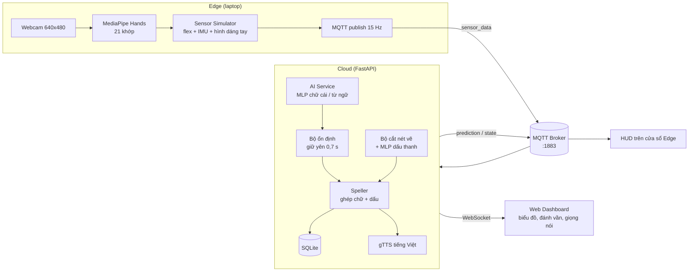
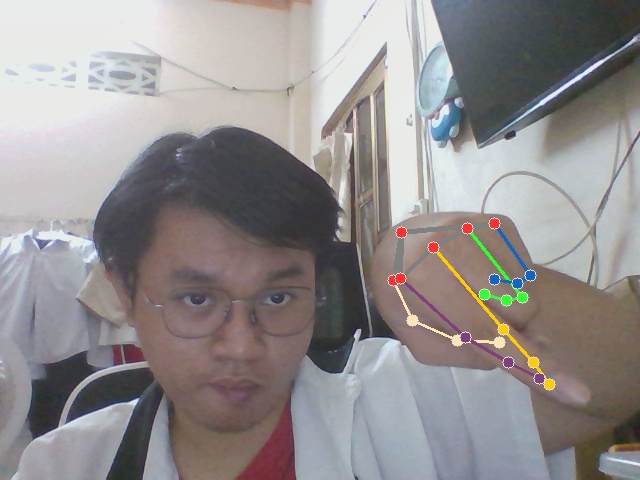
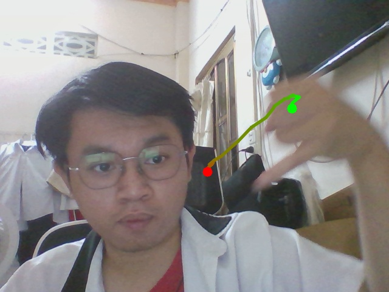

# Báo cáo kỹ thuật — Hệ thống IoT phiên dịch thủ ngữ tiếng Việt thời gian thực

> Tài liệu tổng hợp toàn bộ quá trình xây dựng: kiến trúc, công nghệ, thuật toán, cách đo, số liệu thực tế, các lỗi gặp phải và cách tinh chỉnh.
> Số liệu được lấy từ các lần chạy thật trên máy phát triển (Windows 11, webcam laptop), cập nhật ngày 14/11/2026.

---

## 1. Mục tiêu và phạm vi

| Mục tiêu | Chỉ tiêu | Trạng thái |
|---|---|---|
| Phiên dịch cử chỉ tay thành chữ / câu tiếng Việt và đọc thành tiếng | Chạy thời gian thực | Đạt |
| Độ trễ toàn trình Edge → Cloud → Dashboard | < 500 ms | Đạt: trung bình 2,1–2,3 ms (broker nội bộ) |
| Độ ổn định truyền MQTT | Không mất gói | Đạt: PDR 100% ở 15, 30, 60 Hz |
| Độ chính xác AI | Càng cao càng tốt, đo trên dữ liệu chưa thấy | Chữ cái 90,4%; dấu thanh 94,4%; từ ngữ 99,8–100% |

**Phạm vi nhận diện:**

- **Chế độ Chữ cái:**
  - 23 chữ cái ngón tay tiếng Việt: A B C D Đ E G H I K L M N O P Q R S T U V X Y.
  - Dấu phụ: mũ `^` (â ê ô), móc (ư ơ), trăng `˘` (ă).
  - 5 dấu thanh: sắc, huyền, hỏi, ngã, nặng.
  - 2 cử chỉ điều khiển: xóa chữ, xong từ.
  - Chữ được ghép thành từ có dấu đúng chính tả (ví dụ V‑I‑E‑T + ^ + nặng = **VIỆT**), sau đó đọc thành tiếng.
- **Chế độ Từ ngữ:** 12 cử chỉ câu thông dụng (Xin chào, Cảm ơn, Tôi cần giúp đỡ, Khẩn cấp, …).

**Ý tưởng IoT:** Camera laptop kết hợp MediaPipe đóng vai trò "găng tay cảm biến". Từ 21 khớp bàn tay, Edge tính ra các giá trị mô phỏng cảm biến uốn (flex) cho từng ngón và cảm biến quán tính IMU (roll/pitch/yaw, gia tốc). Như vậy kiến trúc giữ nguyên được khi thay bằng phần cứng thật.

---

## 2. Kiến trúc hệ thống



**Các topic MQTT** (tiền tố `iot/sign_language`):

| Topic | Chiều | Nội dung |
|---|---|---|
| `…/sensor_data` | Edge → Cloud | Gói cảm biến của từng khung hình |
| `…/prediction` | Cloud → Edge | Kết quả nhận diện, trạng thái đánh vần |
| `…/status` | Edge → Cloud | Nhịp tim: fps, có thấy tay không, RTT |
| `…/control` | Dashboard/Edge → Cloud | Đổi chế độ, xóa, xong từ, chỉnh thời gian giữ |

**Gói dữ liệu `sensor_data`** (JSON, khoảng 1 KB):

- Thông tin chung: `device_id`, `seq_id`, `edge_timestamp_ms`, `edge_processing_ms`, `handedness`, `mode`.
- `flex[5]`: độ uốn từng ngón, tính bằng độ.
- `imu{roll, pitch, yaw, ax, ay, az, speed}`.
- `shape[79]`: hình dáng tay đã chuẩn hóa.
- `pointer[x, y, palm]`: đầu ngón trỏ, dùng cho dấu thanh.

---

## 3. Tech stack

| Tầng | Công nghệ | Vai trò |
|---|---|---|
| Thu nhận | **OpenCV 4.11**, **MediaPipe Hands 0.10.21** (`model_complexity=1`) | Đọc webcam, trích 21 khớp bàn tay 3D |
| Edge | Python 3.11, NumPy | Mô phỏng cảm biến flex/IMU, chuẩn hóa, HUD tiếng Việt (Pillow) |
| Mạng | **MQTT 3.1.1**, `paho-mqtt 2.x`, broker nội bộ tự viết (`network/mini_broker.py`, asyncio) | Truyền tin Edge ↔ Cloud, QoS 0 |
| Cloud | **FastAPI** + **Uvicorn**, WebSocket | API, xử lý luồng, đẩy kết quả lên dashboard |
| AI | **scikit-learn**: `StandardScaler` + `MLPClassifier(128, 64)`, `RandomForestClassifier(200)` | Phân loại tư thế tay và nét vẽ |
| Lưu trữ | **SQLite** (chế độ WAL) | Nhật ký dịch, độ trễ, thống kê |
| Giọng nói | **gTTS** (tiếng Việt), có cache mp3 | Đọc từ / câu |
| Giao diện | HTML + CSS + JavaScript thuần, **Chart.js** | Dashboard thời gian thực |
| Đánh giá | Pandas, scikit-learn metrics | Benchmark, ma trận nhầm lẫn, báo cáo md/json |

**Cấu trúc thư mục chính:**

```
config.py                  # toàn bộ tham số, nhãn, ngưỡng
edge/  hand_tracker.py     # MediaPipe + bầu chọn tay trái/phải
       sensor_simulator.py # 21 khớp -> flex/IMU/shape (95 đặc trưng)
       edge_gateway.py     # vòng lặp camera, MQTT, HUD
network/mini_broker.py     # broker MQTT nội bộ
cloud/ server.py           # FastAPI, MQTT, WebSocket, quản lý Edge
       ai_service.py       # bộ phân loại, HoldStabilizer, Speller
       trajectory.py       # cắt nét vẽ + đặc trưng quỹ đạo dấu thanh
       vietnamese.py       # quy tắc đặt dấu tiếng Việt
       train_model.py      # train + đánh giá + chọn mô hình
dataset/collect_data.py    # công cụ thu dữ liệu có hướng dẫn + lưu ảnh
evaluation/benchmark_system.py, live_accuracy_test.py
dashboard/                 # giao diện web
```

---

## 4. Thuật toán chi tiết

### 4.1 Từ khung hình đến vector đặc trưng (95 chiều)

1. **Lật gương (selfie)** khung hình trước khi đưa vào MediaPipe, để nhãn tay trái/phải khớp với người dùng.
2. **Bầu chọn tay trái/phải** theo đa số trên 15 khung gần nhất, vì MediaPipe đôi khi đổi nhãn qua lại.
3. **Chuẩn hóa về một tay chuẩn:** tay trái được lật trục x thành tay phải. Một mô hình dùng được cho cả hai tay.
4. **Chuẩn hóa vị trí và kích thước:** lấy cổ tay làm gốc, chia cho chiều dài lòng bàn tay (khoảng cách từ cổ tay đến khớp gốc ngón giữa). Nhờ vậy đặc trưng không phụ thuộc khoảng cách tới camera.
5. **Các nhóm đặc trưng:**
   - **16 đặc trưng "cảm biến":**
     - 5 giá trị flex: tổng góc gập các khớp mỗi ngón.
     - roll/pitch/yaw tính từ pháp tuyến lòng bàn tay.
     - Gia tốc ax/ay/az và tốc độ.
     - Ngón cái chạm ngón trỏ.
     - Dao động x/y và dao động độ gập, dùng cho cử chỉ động như vẫy tay hay nắm-mở.
   - **60 đặc trưng hình dáng:** 20 khớp × (x, y, z) sau chuẩn hóa.
   - **19 đặc trưng khoảng cách** để tách các chữ gần giống nhau (A/E/M/N/S/T, U/V/R):
     - 12 khoảng cách từ đầu ngón cái tới các khớp khác.
     - Các khoảng cách giữa đầu ngón với nhau.
     - Chỉ số "ngón giữa bắt chéo ngón trỏ" (chữ R).
6. **Đạo hàm không phụ thuộc tần số khung:** vận tốc và gia tốc tính so với mẫu cũ nhất cách hiện tại ≥ 33 ms, không so với khung liền trước (xem lỗi #4 ở mục 7).

### 4.2 Mô hình phân loại tư thế tay

- Có **hai mô hình riêng**, mỗi chế độ một mô hình, lưu chung trong `gesture_classifier.pkl`:
  - Chữ cái: 28 nhãn, gồm 23 chữ, mũ, móc, tư thế dấu, xóa, xong từ.
  - Từ ngữ: 12 nhãn.
  - Tách hai mô hình giúp mỗi mô hình chỉ phải phân biệt ít lớp hơn, nên ít nhầm hơn.
- **Ứng viên:** MLP (`StandardScaler` → 128 → 64 nơ-ron, `alpha=1e-3`, early stopping) và Random Forest (200 cây).
- **Quy tắc chọn:** lấy mô hình **nhanh nhất** trong số các mô hình có accuracy cách mô hình tốt nhất không quá 0,5%. Thực tế MLP suy luận 0,4 ms/mẫu, còn RF mất 9–10 ms, nên chọn MLP.
- **Tăng cường dữ liệu** (chỉ cho tập train): mỗi phiên ghi được tạo thêm 2 bản biến đổi:
  - Xoay ±10°.
  - Co giãn ±15%.
  - Nhiễu Gauss σ = 0,0015 trên mỗi khớp.
- **Nhãn "tư thế dấu"** (`TU_THE_DAU`): không thu riêng. Nó được học từ chính các lần ghi dấu thanh, bằng cách gán lại nhãn các khung trong lúc vẽ. Mô hình chữ cái nhờ đó biết khi nào tay đang ở tư thế chuẩn bị vẽ dấu.

### 4.3 Bộ ổn định "giữ yên" cho chữ cái (`HoldStabilizer`)

Vấn đề: nếu nhận chữ ngay khi mô hình dự đoán đúng vài khung liên tiếp, thì các dáng tay trung gian trong lúc đổi chữ cũng bị nhập.

**Thuật toán (chạy trên mỗi khung):**

1. **Bỏ phiếu** trên 5 khung gần nhất. Một nhãn trở thành *ứng viên* khi:
   - được ít nhất 80% số phiếu (4/5 khung), và
   - độ tin cậy trung bình ≥ 0,75.
2. **Khung đang di chuyển** (tốc độ tâm bàn tay đã làm mượt EMA với α = 0,4, vượt 3,0 lần chiều dài lòng bàn tay mỗi giây) được tính là phiếu trống.
3. Ứng viên phải **giữ nguyên liên tục `hold_ms`** (mặc định 700 ms, chỉnh được 300–2000 ms) thì chữ mới được nhập. Tiến độ 0→1 được gửi lên dashboard và HUD dưới dạng thanh màu cam.
4. Chữ chỉ nhập **một lần** cho mỗi lần giữ. Muốn lặp chữ (ví dụ "OO"), phải có ít nhất 400 ms *không có ứng viên nào*, tức là thả lỏng tay rồi làm lại.
5. Mất tay quá 1 s thì reset. Mất tay quá 1,5 s thì tự động kết thúc từ.

**Cử chỉ điều khiển** dùng chung cơ chế này:

- **Xóa:** nắm tay, ngón cái chỉ xuống. Giữ thì xóa 1 chữ, giữ tiếp thì cứ 900 ms xóa thêm 1 chữ.
- **Xong từ:** xòe 5 ngón. Từ được chốt và đọc thành tiếng.

### 4.4 Nhận diện dấu trăng và dấu thanh theo quỹ đạo ngón trỏ

Đây là các dấu **động**, phân biệt bằng *nét vẽ* chứ không phải dáng tay.

**a) Cắt nét vẽ (`StrokeSegmenter`).** Vận tốc đầu ngón trỏ được đo theo đơn vị chiều dài lòng bàn tay mỗi giây.

| Tham số | Giá trị | Ý nghĩa |
|---|---|---|
| `V_START` | 1,4 | Vận tốc bắt đầu một nét |
| `V_END` / `END_RATIO` | 0,5 / 25% vận tốc đỉnh | Ngưỡng kết thúc nét (lấy giá trị lớn hơn trong hai) |
| `END_HOLD_SEC` | 0,15 s | Phải chậm lại liên tục chừng này mới tính là hết nét |
| Thời lượng hợp lệ | 0,15–2,0 s | Loại cú giật tay và chuyển động quá dài |
| `MIN_PATH` | 0,45 lần lòng bàn tay | Loại rung tay nhỏ |
| Tỉ lệ khung ở tư thế dấu | ≥ 50% | Nét vẽ phải được thực hiện bằng tư thế ngón trỏ |

**b) Đặc trưng nét (41 chiều):**

- 12 điểm lấy mẫu lại theo độ dài cung, chuẩn hóa vị trí bắt đầu và kích thước. Đặc trưng nhờ vậy không phụ thuộc tốc độ vẽ.
- Độ dời x/y, độ dài đường đi, thời lượng.
- Độ thẳng (độ dời chia cho đường đi), kích thước khung bao.
- Số lần đổi chiều theo x/y (dấu ngã có nhiều lần đổi chiều).
- Tổng góc quay có dấu và trị tuyệt đối (dấu hỏi và dấu trăng là đường cong).
- Hướng ngón trỏ trung bình và lúc bắt đầu (dấu nặng chỉ xuống, dấu sắc chỉ chéo lên).

**c) Phân loại:** cũng so sánh MLP và RF như mục 4.2. Tăng cường dữ liệu 15 bản cho mỗi nét:

- Xoay ±12°.
- Co giãn nét 0,75–1,3 lần.
- Nhiễu ngẫu nhiên.
- 50% số bản bị bỏ bớt khung, mô phỏng Edge chạy ở tần số thấp.

**d) Các chốt chống nhận nhầm** (thêm sau khi chạy lại dữ liệu thật, xem mục 7):

- Nét chỉ được tính nếu **trước đó tư thế dấu đã thắng phiếu bầu của bộ ổn định ít nhất 200 ms**, và nét bắt đầu trong vòng 1,5 s sau thời điểm đó.
- Độ tin cậy của nét ≥ 0,70.
- Sau một dấu, phải rời tư thế dấu (≥ 3 khung) hoặc chờ 1,5 s mới nhận dấu tiếp theo.
- Trong lúc đang vẽ, việc nhập chữ được hoãn lại chứ không bị hủy.

### 4.5 Ghép dấu tiếng Việt (`cloud/vietnamese.py`)

- Dùng chuẩn Unicode **NFD/NFC**: tách chữ thành ký tự gốc cộng dấu tổ hợp, thay hoặc thêm dấu, rồi gộp lại.
- **Dấu phụ:**
  - Mũ: A→Â, E→Ê, O→Ô.
  - Móc: O→Ơ, U→Ư. Riêng cặp UO thành ƯƠ, như trong NGƯỜI.
  - Trăng: A→Ă.
- **Vị trí dấu thanh** theo quy tắc chính tả (kiểu cũ), áp dụng theo thứ tự:
  1. Nguyên âm có dấu phụ (Ă Â Ê Ô Ơ Ư) được ưu tiên.
  2. Vần kết thúc bằng phụ âm thì đặt dấu ở nguyên âm cuối.
  3. Các trường hợp đặc biệt QU-, GI-: QUÁ, GÌ.
  4. Còn lại đặt dấu ở nguyên âm thứ nhất của cặp, như HÒA.
- Dấu không áp dụng được (ví dụ móc cho từ không có O/U) thì bị bỏ qua, từ giữ nguyên.
- Đã kiểm thử: VIET + ^ + nặng = VIỆT, NGUOI + móc + huyền = NGƯỜI, HOA + huyền = HÒA, TOAN + sắc = TOÁN, GI + huyền = GÌ, QUA + sắc = QUÁ.

---

## 5. Dữ liệu

### 5.1 Nguồn dữ liệu

| Bộ dữ liệu | Nguồn | Quy mô |
|---|---|---|
| Từ ngữ (12 cử chỉ) | Bàn tay 3D tổng hợp (`edge/hand_model.py`): nhiễu khớp, tần số 15–45 fps, lỗi MediaPipe ngẫu nhiên | 15.474 mẫu |
| Chữ cái, dấu, điều khiển | **Webcam thật của người dùng**, công cụ `collect_data.py camera` | 176 phiên, 12.795 khung |
| Ảnh minh họa | Tự lưu trong lúc thu | 866 ảnh |

Chữ cái **bắt buộc dùng dữ liệu thật**, vì các cặp M/N, S/T, G/Q, K/P chỉ khác nhau rất ít, dữ liệu giả không tái hiện được những khác biệt đó.

**Số phiên ghi hiện có:**
- Mỗi chữ cái 3 phiên × 5 s, khoảng 300 khung (riêng Y có 4 phiên).
- Mũ 4 phiên, móc 5 phiên.
- Mỗi dấu động 15 lần vẽ × 2,5 s.
- Xóa 3 phiên, xong từ 4 phiên.

### 5.2 Quy trình thu (`dataset/collect_data.py camera`)

- Cửa sổ hướng dẫn hiển thị tên nhãn, mô tả cách ra dấu, ảnh tham chiếu bảng chữ cái và bảng dấu, đếm ngược 3 s, thanh tiến độ ghi.
- Mỗi phiên lưu **landmark thô** (21 × 3 tọa độ, thời gian, tay trái/phải) vào `camera_raw.csv`. Vì lưu dữ liệu thô nên khi đổi cách tính đặc trưng chỉ cần train lại, không phải thu lại.
- Dấu động được kiểm tra ngay sau khi ghi: nếu bộ cắt nét không tìm thấy nét nào, công cụ yêu cầu vẽ lại.
- Tham số `--min-rounds` tự thu bù cho những nhãn còn ít dữ liệu.
- **Ảnh cho báo cáo** (`dataset/images/`):
  - Mỗi phiên 3 ảnh gốc và 3 ảnh có khung xương bàn tay, lấy cách đều trong thời gian ghi.
  - Dấu động có thêm ảnh quỹ đạo đầu ngón trỏ, màu chuyển từ xanh (bắt đầu) sang đỏ (kết thúc).
  - Phím `C` chụp nguyên màn hình kèm chữ hướng dẫn.
  - `index.csv` ghi lại phiên, nhãn, loại ảnh và thời gian.
  - Xóa một phiên (phím `X`) thì ảnh của phiên đó cũng bị xóa theo.

Ví dụ:

| Khung xương (dấu huyền) | Quỹ đạo (dấu nặng) |
|---|---|
|  |  |

---

## 6. Phương pháp đo và đánh giá

### 6.1 Độ chính xác mô hình: chia theo phiên ghi

- **Không chia ngẫu nhiên theo khung hình.** Các khung liền nhau trong cùng một phiên gần như giống hệt nhau, chia ngẫu nhiên sẽ cho accuracy ảo, gần 100%.
- Thay vào đó, khoảng 20% số **phiên ghi** của mỗi nhãn (ít nhất 1 phiên) được giữ riêng làm tập kiểm tra. Mô hình chưa từng thấy các phiên này. Dữ liệu tăng cường chỉ đưa vào tập train.
- Chỉ số: accuracy, F1 macro, precision/recall từng lớp, ma trận nhầm lẫn (`evaluation/reports/confusion_matrix_*.csv`), thời gian suy luận mỗi mẫu.
- Sau khi đánh giá, mô hình cuối cùng được train lại trên toàn bộ dữ liệu.

### 6.2 Độ trễ và độ ổn định MQTT (`evaluation/benchmark_system.py`)

- Một thiết bị benchmark phát gói cảm biến tổng hợp qua MQTT ở tần số 15, 30 và 60 Hz, mỗi mức 10 s. Đồng thời nó đăng ký nhận kết quả trả về.
- Mỗi gói mang `seq_id` và thời điểm gửi. Các chỉ số đo:
  - **Uplink:** thời gian từ Edge qua broker tới Cloud.
  - **Cloud:** thời gian suy luận cộng ổn định cộng ghi CSDL.
  - **E2E** = uplink + Cloud, tức thời điểm kết quả sẵn sàng đẩy lên dashboard.
  - **RTT:** Edge → Cloud → Edge, đi qua mạng hai lần, là cận trên bi quan.
  - **PDR** = số gói nhận / số gói gửi, phát hiện mất gói qua lỗ hổng trong `seq_id`.
  - Accuracy trên luồng liên tục.
- Accuracy qua HTTP API: 30 lần ra dấu × 12 cử chỉ, dùng seed khác với lúc train.

### 6.3 Phát lại dữ liệu thật qua toàn bộ pipeline (kiểm thử hồi quy)

- Các phiên ghi thật được đưa qua đúng hàm xử lý của Cloud (`server.cloud.process`), giống hệt luồng thời gian thực.
- **Bài 1, đánh vần cả bảng chữ cái:**
  - Nối 23 chữ, mỗi chữ giữ 2,5 s.
  - Có 3 kiểu chuyển tay: chuyển tức thì, và nội suy hình dáng tay từ chữ trước sang chữ sau trong 0,3 s và 0,8 s.
  - Chạy trên 2 bộ phiên: cũ nhất và mới nhất, tổng 6 kịch bản.
  - Đạt khi kết quả đúng chuỗi `ABCDEGHIKLMNOPQRSTUVXYĐ`, không thừa và không thiếu.
- **Bài 2, tỉ lệ nhận dấu:** phát lại 90 lần vẽ dấu thật, mỗi lần có 0,5 s giữ tư thế trước, rồi đếm số lần dấu được ghép đúng vào từ.
- **Bài 3, kịch bản đầy đủ:** V → I → E → T → mũ → dấu nặng → giữ xóa 1,3 s → xòe 5 ngón. Kết quả kỳ vọng: VIỆT, rồi VIỆ, rồi chốt từ.

### 6.4 Kiểm tra thực tế với camera (`evaluation/live_accuracy_test.py`)

Công cụ yêu cầu người dùng ra lần lượt từng ký hiệu trước camera, ghi lại dự đoán của Cloud, rồi xuất báo cáo md/json theo từng nhóm. Dấu động được chấm bằng bộ cắt nét cộng mô hình nét vẽ.

---

## 7. Lỗi thực tế và cách tinh chỉnh

Các lỗi được xếp theo thứ tự thời gian phát hiện. Mỗi lỗi ghi lại hiện tượng, cách đo hoặc nguyên nhân, cách xử lý và kết quả.

| # | Hiện tượng | Nguyên nhân (đo được) | Cách xử lý | Kết quả |
|---|---|---|---|---|
| 1 | Mô hình từ ngữ đạt 100% ngay lần đầu | Dữ liệu tổng hợp quá "sạch", các lớp tách biệt quá dễ, không thực tế | Tăng biên độ gập ngón và nhiễu khớp, thêm lỗi MediaPipe ngẫu nhiên (một khớp bị lệch) | Còn 99,1–99,5%, xuất hiện các nhầm lẫn hợp lý (Chờ một chút ↔ Tôi bị đau) |
| 2 | Biểu đồ flex của bàn tay mở dao động 20–140° (lẽ ra gần 0) | Nhiễu khớp σ = 10° cộng với việc cắt giá trị âm về 0, làm nhiễu luôn bị đẩy lên | Giảm nhiễu và xử lý lại giới hạn trong mô hình bàn tay | Flex của bàn tay mở về gần 0 |
| 3 | Tần số gửi thực tế 11,6 gói/s thay vì 15 Hz | Camera 30 fps: khoảng cách giữa các khung không chia hết cho 1/15 s, nên thỉnh thoảng bị bỏ qua 2 khung | Chấp nhận sai số khoảng thời gian 90% | Đạt 15,0 Hz |
| 4 | Accuracy giảm ở 100 Hz | Vận tốc/gia tốc tính bằng sai phân khung liền kề: khoảng thời gian càng nhỏ nhiễu càng bị khuếch đại, phân phối dữ liệu lệch so với lúc train | Tính đạo hàm so với mẫu cũ nhất cách hiện tại ≥ 33 ms; train với tần số 15–45 fps | 100% ở mọi tần số 15 / 30 / 60 / 100 Hz |
| 5 | Bộ đếm "gói đã nhận" bị reset khi khởi động lại Edge | `seq_id` bắt đầu lại từ 0 | Thống kê theo từng phiên Edge, cộng dồn qua các lần khởi động lại | Số liệu PDR liên tục |
| 6 | Broker công cộng EMQX: PDR chỉ 57% (15 Hz) và 33% (30 Hz), RTT 500–600 ms | Broker miễn phí giới hạn khoảng 10 gói/s mỗi client; máy chủ ở xa (uplink một chiều 250–390 ms) | Mặc định dùng broker nội bộ tự viết (asyncio, MQTT 3.1.1). Với broker công cộng nên gửi ≤ 8 Hz. Báo cáo tách E2E một chiều khỏi RTT | Broker nội bộ: PDR 100%, E2E khoảng 2–3 ms. EMQX ở dưới ngưỡng giới hạn: PDR 100%, E2E khoảng 360–390 ms (< 500 ms) |
| 7 | `run_demo` báo Cloud không khởi động được, không có thông báo lỗi | Riêng việc import thư viện đã mất 17 s (ổ đĩa nguội, phần mềm diệt virus quét), cộng thời gian kết nối MQTT, vượt giới hạn chờ 30 s | Tăng giới hạn chờ lên 90 s | Khởi động ổn định |
| 8 | Chữ cái không tách được bằng flex/IMU (A/E/M/N/S trùng nhau) | 5 giá trị flex không mô tả được vị trí ngón cái hay ngón bắt chéo | Thêm 60 đặc trưng hình dáng và 19 đặc trưng khoảng cách, chuẩn hóa tay trái/phải, dùng MediaPipe `model_complexity=1`, thu dữ liệu thật | Mô hình đầu tiên đạt 81,7% |
| 9 | Dấu thanh không được cắt nét ở 15 Hz | Nhiễu vận tốc khoảng 0,4, quá gần ngưỡng kết thúc tuyệt đối `V_END = 0,5`, nên nét không bao giờ kết thúc hoặc bị cắt vụn | Thêm ngưỡng kết thúc tương đối bằng 25% vận tốc đỉnh, giữ 0,15 s | Cắt đúng mọi nét; nhận đúng 28–30/30 nét trên dữ liệu thử |
| 10 | Edge báo lỗi (mã thoát 1) khi bấm nút "Tắt Edge" | Lệnh `terminate` trên Windows luôn trả về mã 1 | Ghi nhận trạng thái "người dùng chủ động tắt" | Chỉ báo lỗi khi Edge dừng bất thường |
| 11 | **Người dùng phản ánh: chữ nhận quá nhanh, chưa kịp đổi tay đã nhận sai** | Cách cũ: 7 khung (khoảng 0,47 s) cùng một nhãn là nhập. Phát lại bảng chữ cái với chuyển tay 0,8 s cho ra thừa R và Đ: `ABCDEG`**R**`HIKLMN`**Đ**`OPQ…` | Viết `HoldStabilizer` (mục 4.3): bỏ phiếu 4/5 khung, giữ yên 0,7 s, có thanh tiến độ, chỉnh được thời gian giữ | Hết chữ thừa khi chuyển tay |
| 12 | **Người dùng phản ánh: xóa chữ phải dùng chuột** | Chưa có cử chỉ điều khiển | Thêm 2 nhãn XOA (ngón cái chỉ xuống, giữ để xóa liên tục mỗi 900 ms) và CACH (xòe 5 ngón = xong từ), thu dữ liệu riêng | Recall 100% cho XOA; điều khiển hoàn toàn bằng cử chỉ |
| 13 | Sau khi thêm bộ ổn định mới, D, G, M, N **không bao giờ được nhập** | Mô hình vẫn đúng 76/76 khung, nhưng bộ lọc chuyển động gắn cờ "đang di chuyển" cho G 53/76 khung, M 30/77. Tốc độ đổi hình dạng ngón của G khi giữ yên có trung vị khoảng 7, sát ngưỡng 8 | Làm mượt tốc độ bằng EMA (α = 0,4) và nâng ngưỡng | Đủ 23/23 chữ |
| 14 | Một chữ bị nhập 2 lần (RR, DD) | Cơ chế "cho phép lặp chữ" tính cả *thời gian chờ giữ đủ* là "không ổn định", nên chỉ cần độ tin cậy chập chờn một nhịp là chữ bị mở khóa | Chỉ tính "không ổn định" khi **không có ứng viên nào** | Hết nhập trùng |
| 15 | Sau khi train dữ liệu mới, G, I, L, M, S lại bị sót | Lúc thu, công cụ hướng dẫn *cố ý di chuyển nhẹ tay*. Tốc độ tâm bàn tay trung vị 1,3–1,8, đỉnh 4,8. Tốc độ đổi hình dạng của G trung vị 21,8 dù mô hình vẫn đúng 75/75 khung | **Bỏ điều kiện tốc độ đổi hình dạng ngón**, ngưỡng tốc độ tâm bàn tay 3,0. Việc chặn tư thế trung gian giao cho điều kiện bỏ phiếu cộng giữ 0,7 s, vì lúc chuyển chữ kết quả nhận diện luôn nhảy lung tung | Hết sót chữ |
| 16 | Dấu bị chèn nhầm khi đánh vần: D‑E thành D‑**É**, I thành **Í**, O thành **Ọ** | Các chữ D và I có ngón trỏ giơ lên, nên xác suất "tư thế dấu" theo từng khung ≥ 0,3. Chuyển động lúc đổi chữ bị cắt thành một nét vẽ | Nâng ngưỡng tư thế lên 0,5, độ tin cậy nét lên 0,7. **Nét chỉ hợp lệ khi tư thế dấu đã thắng phiếu bầu của bộ ổn định ≥ 200 ms trước đó** (không dựa vào từng khung lẻ) | 0 dấu bị chèn nhầm trong 6 kịch bản; vẫn nhận đúng 96,7% nét vẽ thật |
| 17 | Chữ G bị mất khi chuyển từ E sang G | G (ngón trỏ chỉ ngang) giống tư thế dấu, nên bộ cắt nét ở trạng thái "đang vẽ" 1,6 s và khóa việc nhập chữ. Bộ ổn định đã "tiêu" lượt nhập G trong lúc bị khóa | Chỉ khóa khi tư thế dấu đã sẵn sàng. Nếu bị khóa thì trả lại lượt nhập (`release`) để nhập sau | 6/6 kịch bản đúng 23/23 chữ |
| 18 | Server mới không nghe được cổng 8000 | Một tiến trình Python cũ vẫn chiếm cổng (venv chạy Python thật dưới dạng tiến trình con) | Dừng tiến trình cũ; chạy server trong cửa sổ PowerShell riêng để không bị dừng theo terminal | Server chạy ổn định |

### 7.1 Diễn biến kết quả phát lại bảng chữ cái

Chuỗi đúng là `ABCDEGHIKLMNOPQRSTUVXYĐ`.

| Phiên bản | Chuyển tức thì | Chuyển 0,3 s | Chuyển 0,8 s |
|---|---|---|---|
| Cũ (7 khung, khoảng 0,47 s) | thừa D | đúng | thừa R, Đ |
| Giữ yên 0,7 s, bộ lọc chuyển động gắt (lỗi #13) | thiếu D, G, M, N | — | — |
| Đã làm mượt EMA, chưa sửa lặp chữ (lỗi #14) | thừa R | thừa D | thừa D |
| Mô hình mới, phiên mới nhất (lỗi #15–#17) | thiếu G, I, L, M, S; thừa Ọ | thiếu G; thừa Ọ | thiếu G, O, Q; thừa É |
| **Bản hiện tại** (6 kịch bản: 2 bộ phiên × 3 kiểu chuyển) | **đúng** | **đúng** | **đúng** |

---

## 8. Kết quả hiện tại

### 8.1 Độ chính xác mô hình (tập kiểm tra là các phiên ghi chưa thấy khi train)

| Mô hình | Thuật toán được chọn | Accuracy | F1 macro | Suy luận/mẫu | Dữ liệu train / test |
|---|---|---|---|---|---|
| Chữ cái, 28 nhãn | MLP (RF: 90,7%, 9,85 ms) | **90,44%** | 89,64% | 0,41 ms | 23.448 / 4.099 khung |
| Dấu động, 6 nhãn | MLP | **94,44%** | 94,29% | 0,24 ms | 1.057 (đã tăng cường) / 18 nét |
| Từ ngữ, 12 nhãn | MLP | **100%** | 100% | 0,59 ms | 12.447 / 3.027 mẫu |

**Chữ cái qua hai lần thu:** 81,7% (2 phiên mỗi chữ), rồi **90,4%** (3 phiên mỗi chữ, có thêm cử chỉ điều khiển và dấu).

**Các cặp còn hay nhầm** (số khung trong tập kiểm tra):

| Nhãn thật | Bị nhận thành | Số khung | Giải thích |
|---|---|---|---|
| O | Móc | 101 | Hai dáng tay đều cong ngón tạo vòng |
| V | U | 83 | Chỉ khác độ tách hai ngón |
| Q | Tư thế dấu | 78 | Cùng một ngón trỏ duỗi chĩa ra |
| T | Xong từ | 48 | — |
| N | M | 39 | Khác nhau 1 ngón phủ lên ngón cái |

Recall các chữ yếu: O 31%, V 43%, Q 47%, T 67%, N 73%, L 88%. Các chữ còn lại phần lớn đạt 94–100%.

> Lưu ý: mỗi nhãn chỉ có 1 phiên kiểm tra (khoảng 150 khung), nên recall từng chữ dao động nhiều. Khi dùng thật, bộ ổn định (bỏ phiếu cộng giữ 0,7 s) giúp chuỗi chữ đúng hơn đáng kể so với accuracy từng khung, như kết quả ở mục 8.3.

### 8.2 Độ trễ và độ ổn định mạng (đo ngày 14/11/2026, broker nội bộ)

| Tần số | Gửi / nhận | PDR | E2E trung bình | E2E p95 | E2E < 500 ms | RTT trung bình | RTT p95 | Accuracy luồng |
|---|---|---|---|---|---|---|---|---|
| 15 Hz | 150 / 150 | 100% | 2,12 ms | 3,06 ms | 100% | 2,91 ms | 4,03 ms | 100% |
| 30 Hz | 300 / 300 | 100% | 2,24 ms | 3,06 ms | 100% | 3,23 ms | 4,08 ms | 99,04% |
| 60 Hz | 600 / 600 | 100% | 2,28 ms | 3,08 ms | 100% | 3,21 ms | 4,17 ms | 100% |

- Accuracy qua HTTP API: **99,83%** trên 1.170 mẫu mới; độ trễ API trung bình 3,48 ms.
- Số lần MQTT phải kết nối lại: 0.
- **Với camera thật:**
  - Camera chạy 15–30 fps (thường khoảng 15–23 fps khi có HUD).
  - MediaPipe (complexity 1) mất 15–25 ms/khung; xử lý Edge khoảng 9,5 ms.
  - RTT Edge → Cloud → Edge khoảng 11–30 ms.
- **Với broker công cộng EMQX:** E2E khoảng 360–390 ms, vẫn dưới 500 ms, nhưng phải gửi ≤ 8 Hz do giới hạn băng thông của broker.
- **Phân biệt hai loại độ trễ:**
  - Độ trễ hệ thống mỗi khung là vài ms.
  - Độ trễ cảm nhận khi đánh vần còn cộng thêm thời gian giữ chữ 0,7 s. Đây là **lựa chọn thiết kế** để chống nhận nhầm và chỉnh được 0,3–2 s.

### 8.3 Kiểm thử hồi quy trên dữ liệu thật (bản hiện tại)

| Bài kiểm tra | Kết quả |
|---|---|
| Đánh vần cả bảng chữ cái, 6 kịch bản (2 bộ phiên × 3 kiểu chuyển tay) | **6/6 đúng tuyệt đối**: 23/23 chữ, 0 chữ thừa, 0 dấu thừa |
| Nhận dấu trên 90 lần vẽ thật | **96,7%** được ghép đúng vào từ |
| V‑I‑E‑T + ^ + nặng → xóa → xong từ | VIET → VIÊT → **VIỆT** → VIỆ → chốt từ (đúng cả 3 lần thử với 3 lần vẽ dấu khác nhau) |

---

## 9. Hạn chế và hướng phát triển

1. **Dữ liệu chỉ của một người, 3 phiên mỗi chữ.** Cần thu thêm từ nhiều người, nhiều điều kiện ánh sáng và góc camera. Ưu tiên các chữ O, V, Q, T, N.
2. **Tập kiểm tra nhỏ** (1 phiên mỗi nhãn, 18 nét cho dấu động), nên số liệu từng lớp còn dao động. Nên đánh giá chéo theo phiên (leave-one-session-out) khi có nhiều dữ liệu hơn.
3. **Cặp O/Móc và Q/Tư thế dấu** có thể tách tốt hơn nếu thêm đặc trưng hướng lòng bàn tay so với camera, hoặc dùng mô hình chuỗi (1D-CNN/GRU) trên vài khung liên tiếp.
4. Chế độ Từ ngữ đang dùng dữ liệu tổng hợp. Cần thu dữ liệu camera thật (`--group words`) trước khi đánh giá độ chính xác ngoài thực tế.
5. **Phần cứng thật:** thay camera bằng găng tay flex + IMU (ESP32) mà không phải sửa Cloud, vì gói dữ liệu đã có sẵn trường `flex` và `imu`.
6. **Bảo mật MQTT:** khi triển khai qua Internet, nên dùng TLS (cổng 8883) và xác thực bằng tài khoản. Cấu hình đã hỗ trợ `MQTT_USERNAME`/`MQTT_PASSWORD`.

---

## 10. Hướng dẫn chạy và tái lập số liệu

```powershell
cd d:\IOT_Do_An_Thu_Ngu_Nhan_Dien
$env:PYTHONIOENCODING="utf-8"

# Chạy hệ thống (broker + Cloud), sau đó bật Edge bằng nút trên dashboard http://127.0.0.1:8000
.\.venv\Scripts\python.exe run_demo.py --no-edge

# Thu dữ liệu (tự lưu ảnh vào dataset/images)
.\.venv\Scripts\python.exe dataset/collect_data.py camera --group letters,controls,marks --rounds 1 --min-rounds 3
.\.venv\Scripts\python.exe dataset/collect_data.py stats

# Train lại cả mô hình chữ cái, từ ngữ và dấu động -> evaluation/reports/training_report.json
.\.venv\Scripts\python.exe cloud/train_model.py

# Benchmark độ trễ / MQTT / accuracy -> evaluation/reports/benchmark_*.md
.\.venv\Scripts\python.exe evaluation/benchmark_system.py --rates 15,30,60 --duration 10

# Kiểm tra trực tiếp với camera
.\.venv\Scripts\python.exe evaluation/live_accuracy_test.py
```

**Các tham số tinh chỉnh chính** (`config.py`):

| Tham số | Giá trị | Ý nghĩa |
|---|---|---|
| `LETTER_HOLD_MS` | 700 (300–2000) | Thời gian giữ yên để nhập chữ; chỉnh được trên dashboard hoặc bằng phím `+`/`-` trên Edge |
| `LETTER_STILL_SPEED` | 3,0 lần lòng bàn tay/s | Ngưỡng tay "đang di chuyển" (sau EMA) |
| `LETTER_MOTION_EMA` | 0,4 | Hệ số làm mượt tốc độ |
| `DELETE_REPEAT_MS` | 900 | Chu kỳ xóa khi giữ cử chỉ xóa |
| `SPELL_AUTO_COMMIT_MS` | 1500 | Bỏ tay khỏi khung hình chừng này thì tự chốt từ |
| `MARK_MIN_CONFIDENCE` | 0,7 | Độ tin cậy tối thiểu của nét dấu |
| `MARK_POSE_CONF` | 0,5 | Xác suất tối thiểu để một khung được tính là tư thế dấu |
| `MARK_POSE_READY_MS` / `MARK_POSE_WINDOW_MS` | 200 / 1500 | Giữ tư thế trước khi vẽ / thời gian tối đa từ lúc sẵn sàng đến lúc bắt đầu nét |
| `PUBLISH_HZ` | 15 | Tần số gửi của Edge (nên ≤ 8 Hz khi dùng broker công cộng) |
