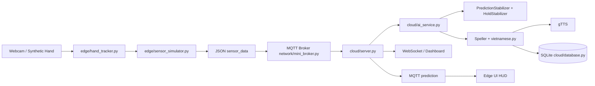
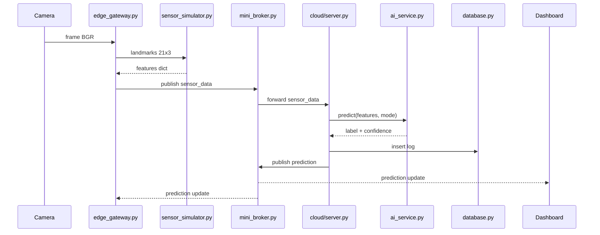

# Technical Documentation — Nhan_Dien_Thu_Ngu

## 1. Tổng quan dự án

Dự án `T-senpai7/Nhan_Dien_Thu_Ngu` là một hệ thống IoT / AI thời gian thực cho phép người dùng ký hiệu tay thành chữ/câu tiếng Việt, sau đó đọc thành giọng nói. Trong code, hệ thống được tổ chức theo kiến trúc Edge–Cloud–Dashboard, trong đó:

- `edge/` thu nhận khung hình từ webcam hoặc dữ liệu giả lập, trích xuất 21 landmarks bàn tay bằng MediaPipe, chuyển thành vector cảm biến và phát lên MQTT.
- `network/` cung cấp broker MQTT nội bộ hoặc client kết nối tới broker bên ngoài.
- `cloud/` nhận stream cảm biến, chạy phân loại AI, ổn định kết quả, ghép chữ, xử lý dấu thanh và đọc giọng nói bằng gTTS.
- `dashboard/` hiển thị trạng thái và các biểu đồ nền tảng.
- `dataset/` và `evaluation/` phục vụ thu thập, huấn luyện và đánh giá mô hình.

### Mục tiêu kinh doanh / kỹ thuật

Dự án giải quyết bài toán:

- chuyển cử chỉ tay trong thực tế thành chữ viết và câu tiếng Việt;
- hỗ trợ giao tiếp cho người khiếm thính / người học ngôn ngữ ký hiệu;
- cho phép chẩn đoán và giám sát thời gian thực: độ trễ, độ ổn định, xác suất, tỷ lệ mất gói MQTT.

### Cấu trúc công nghệ được xác nhận từ code

Theo `requirements.txt` và source, stack chính là:

- Python 3
- OpenCV + MediaPipe Hands
- NumPy, pandas, scikit-learn, joblib
- MQTT via `paho-mqtt`
- FastAPI + Uvicorn
- SQLite
- gTTS
- WebSocket / dashboard HTML/JS

## 2. Repository map

### Cấu trúc thư mục chính

| Đường dẫn | Tên | Chức năng | Thành phần liên quan |
|---|---|---|---|
| `config.py` | Cấu hình toàn hệ thống | Khai báo MQTT, topic, nhãn ngón tay, ngưỡng, path model, đường dẫn dữ liệu | Tất cả module |
| `run_demo.py` | Launcher demo | Khởi tạo broker, server cloud, edge gateway | Edge + Cloud |
| `requirements.txt` | Dependency | Danh sách thư viện | Python environment |
| `edge/` | Edge processing | Thu nhận dữ liệu, giả lập cảm biến, gửi MQTT | Camera / synthetic data |
| `network/` | Network | MQTT broker nội bộ + client | Transport layer |
| `cloud/` | Cloud AI | Server, AI, trajectory, database, spelling | ML + backend |
| `dashboard/` | Frontend | UI thời gian thực | Browser-based display |
| `dataset/` | Data collection | Lưu dữ liệu, ảnh, script thu thập | Training |
| `evaluation/` | Benchmark | Kiểm thử độ chính xác và latency | QA |
| `BaoCao_TaiNguyen/` | Assets / supporting docs | Tài nguyên báo cáo, hình ảnh, video | Documentation |
| `BAO_CAO_KY_THUAT.md` | Báo cáo kỹ thuật | Mô tả kiến trúc và đánh giá | Report |

### Các file cốt lõi đã đọc và vai trò

| File | Vai trò thực tế |
|---|---|
| `config.py` | "single source of truth" cho hầu hết các tham số như topic MQTT, cửa sổ thời gian ổn định, tên chữ, từ, mức tin cậy, path model, cấu trúc data |
| `run_demo.py` | Khởi động đồng bộ: broker local, cloud server, mở dashboard và edge gateway |
| `edge/hand_tracker.py` | Gói MediaPipe Hands, xác định tay dựa trên 21 landmark, lật gương và chuẩn hóa |
| `edge/sensor_simulator.py` | Chuyển 21 landmark thành vector cảm biến: flex, IMU, motion, shape, pointer |
| `edge/edge_gateway.py` | Vòng lặp xử lý camera, publish MQTT, HUD, nhận lại kết quả từ cloud |
| `network/mini_broker.py` | Broker MQTT mini asyncio hỗ trợ CONNECT/PUBLISH/SUBSCRIBE/WILDCARD |
| `network/mqtt_client.py` | Wrapper cho `paho-mqtt` dùng ở edge và cloud |
| `cloud/ai_service.py` | Chứa `GestureClassifier`, `PredictionStabilizer`, `HoldStabilizer`, `Speller` |
| `cloud/trajectory.py` | Phân đoạn nét vẽ và mô hình phân loại dấu thanh |
| `cloud/vietnamese.py` | Quy tắc ghép dấu tiếng Việt, áp dụng dấu thanh và dấu phụ |
| `cloud/database.py` | SQLite cho dữ liệu cảm biến, log, latency, translations |
| `cloud/server.py` | FastAPI server tích hợp MQTT, WebSocket, lưu log, API health, quản lý Edge |

## 3. Kiến trúc hệ thống

### Kiến trúc tổng thể



### Ý nghĩa từng khối

1. `edge/hand_tracker.py`
   - Quá trình bắt đầu ở khung hình bgr.
   - MediaPipe Hands phát 21 landmarks cho bàn tay.
   - Hệ thống giữ một cửa sổ handedness để ổn định nhãn tay trái/phải.

2. `edge/sensor_simulator.py`
   - Từ landmarks, tính toán:
     - `flex_*`: độ uốn của mỗi ngón;
     - `roll / pitch / yaw`: hướng bàn tay;
     - `speed`, `ax`, `ay`, `az`: chuyển động và gia tốc;
     - `shape`: 79 chiều mô tả hình dạng bàn tay, chuẩn hóa theo palm size;
     - `pointer`: vị trí đầu ngón trỏ, phục vụ phát hiện dấu thanh.

3. `network/mini_broker.py`
   - Broker MQTT mini rất nhẹ, xử lý CONNECT, PUBLISH, SUBSCRIBE, wildcard `+` và `#`.
   - Đây là lớp trung gian để `edge` và `cloud` không cần một broker hệ thống bên ngoài khi chạy local.

4. `cloud/server.py`
   - Server FastAPI lắng nghe message MQTT và WebSocket.
   - Định nghĩa API như `/api/health`, `/api/stats`, `/api/recent`, `/api/controls` theo các đoạn code trong file.
   - Server tiền xử lý và phân loại từ stream, đồng thời lưu dữ liệu log qua `cloud/database.py`.

5. `cloud/ai_service.py`
   - `GestureClassifier`: gọi các model `.pkl` được training.
   - `PredictionStabilizer`: bỏ phiếu theo khung để ổn định label.
   - `HoldStabilizer`: đảm bảo chữ chỉ được chấp nhận khi tay giữ nguyên lâu đủ `hold_ms`.
   - `Speller`: ghép chữ và từ, áp dụng dấu tiếng Việt.

## 4. Luồng hoạt động chi tiết

### 4.1 Luồng chính: camera → AI → chữ → đọc thành tiếng

#### 1) Bắt đầu

- `run_demo.py` tạo broker nếu dùng local.
- Nó khởi chạy `cloud/server.py`.
- Nếu không dùng `--no-edge`, nó khởi chạy `edge/edge_gateway.py`.

#### 2) Edge thu nhận dữ liệu

`edge/edge_gateway.py`:

- khởi tạo `SensorSimulator`;
- khởi tạo `MqttLink` với subscription topic `config.TOPIC_PREDICTION`;
- trong `handle_frame()`, nếu phát hiện bàn tay thì gọi `self.sim.process(...)`, thu được `features`.
- tạo payload JSON và publish lên `config.TOPIC_SENSOR`.

Fragment chính:

```python
features = self.sim.process(landmarks, capture_t, handedness)
payload = build_payload(features, self.device_id, self.seq_id, capture_t * 1000, processing_ms, ground_truth)
self.mqtt.publish(config.TOPIC_SENSOR, json.dumps(payload))
```

#### 3) MQTT phân phối dữ liệu

`network/mini_broker.py` nhận packet MQTT và gọi `route(topic, payload)`. Nó kiểm tra `session.subscriptions` và fan-out tới mọi client đăng ký topic phù hợp.

#### 4) Cloud xử lý

`cloud/server.py` nhận message trên `sensor_data`, giải mã JSON và gọi AI service. Logic tổng quát:

- đọc `payload_to_features()` (được định nghĩa trong `edge/sensor_simulator.py`)
- predict theo `GestureClassifier` theo mode `letters` hoặc `words`
- stabilizer bỏ phiếu và xác nhận label;
- `Speller.add(...)` ghi chữ/ từ; nếu là chữ cái, dành cho `letters` mode thì theo `vietnamese.py` sẽ ghép dấu phụ / dấu thanh.

#### 5) Kết quả trả về cho edge

Cloud phát kết quả lên topic `prediction`. Edge nhận `on_prediction()`, cập nhật `self.mode`, `self.spelling`, `self.last_prediction` và hiển thị HUD.

#### 6) Đọc thành tiếng

`cloud/server.py` hoặc `gTTS` path được kích hoạt khi hiện có từ hoặc câu đã commit, phục vụ phát âm tiếng Việt. Đây là phần tích hợp ở tầng Cloud, nhưng source hiện đọc không cho thấy full logic tts nếu chưa mở thêm các file phụ trong `dashboard` và `cloud/server.py` đoạn còn lại.

### 4.2 Chế độ `letters`

- Dùng `config.LETTERS` và `config.MARKS_STATIC` / `MARKS_DYNAMIC`
- Bỏ phiếu trên 5 khung gần nhất; `HoldStabilizer` kiểm tra `hold_ms`
- Khóa chữ khi tay giữ yên đủ dài
- `Speller` ghép dấu theo phép toán chữ tiếng Việt

### 4.3 Chế độ `words`

- Dùng `config.WORDS` như `XIN_CHAO`, `CAM_ON`, `KHAN_CAP`
- Mô hình AI dự đoán 12 nhãn từ; kết quả được dùng cho câu nói và đọc giọng.

### 4.4 Luồng sáng tỏ về dữ liệu



## 5. Phân tích thuật toán

### 5.1 Thuật toán trích xuất cảm biến từ landmarks

#### Phần này nằm trong `edge/sensor_simulator.py`

- `flex_angles(lm)` qua chuỗi điểm `thumb/index/middle/ring/pinky` và sử dụng `bend` angle:

```python
def _bend(a, b, c):
    u, v = b - a, c - b
    denom = np.linalg.norm(u) * np.linalg.norm(v)
    return degrees(arccos(dot(u, v)/denom))
```

- Sau đó tổng góc ở ba khớp gần nhất và chuẩn hóa theo `FINGER_MAX_BEND`:

```python
result[name] = clip(total * 180.0 / FINGER_MAX_BEND[name], 0, 180)
```

#### Mục đích

- biểu diễn độ cong ngón tay thành biến số tương tự cảm biến flex;
- loại bỏ phụ thuộc trực tiếp vào kích thước bàn tay và xa camera;
- làm feature độc lập hơn với size và góc chụp.

#### Độ phức tạp

- `flex_angles`: cho mỗi ngón, xét 3 đoạn và tổng, nên O(5×3) ≈ O(1).

### 5.2 Thuật toán ổn định prediction (`PredictionStabilizer`)

#### File: `cloud/ai_service.py`

- Hệ thống duy trì `deque(maxlen=window)` chứa các label và confidence gần nhất.
- Chọn label chiếm đa số trong cửa sổ;
- Chỉ accept nếu số phiếu và `mean_conf >= threshold`.

```python
if votes < int(self.window * 0.7 + 0.5) or mean_conf < self.threshold:
    return None, False
```

#### Tại sao cần?

Vì mô hình học trên từng khung không đảm bảo khung hình luôn đúng. Hệ thống phải lọc ra nhiễu “đảo chữ” hoặc chuyển động giữa các chữ. Đây là lớp chống nhảy label/flash label.

### 5.3 Thuật toán `HoldStabilizer`

#### File: `cloud/ai_service.py`

- Xây dựng `candidate` theo cùng logic phiếu bầu;
- tính `progress = (ts_ms - since) / hold_ms`;
- chỉ emit chữ khi `progress >= 1`.

`hold_ms` mặc định được config bằng `LETTER_HOLD_MS = 700`, có thể thay từ `300` đến `2000` ms.

#### Cơ chế quan trọng

- `moving=True` sẽ bỏ qua khung đang chuyển động; tức không cho phép dựng chữ từ tay đang chuyển.

### 5.4 Thuật toán nhận diện dấu thanh (`StrokeSegmenter` và `MarkClassifier`)

#### File: `cloud/trajectory.py`

- Một stroke bắt đầu khi vận tốc đầu ngón trỏ vượt ngưỡng `V_START = 1.4` và `pose` đúng.
- Kết thúc khi vận tốc giảm xuống `max(V_END, END_RATIO * peak)` trong `END_HOLD_SEC = 0.15s`.
- Jitter / chuyển động quá ngắn bị loại bỏ.

Các đặc trưng được lấy:

- `rx0..rx11`, `ry0..ry11`: 12 điểm tương ứng theo chiều dài cung;
- `disp_x`, `disp_y`, `path`, `duration`, `straightness`;
- `rev_x`, `rev_y`, `turn`, `abs_turn`;
- `dir_mean_x`, `dir_mean_y`, ...

Hệ thống chỉ chấp nhận stroke nếu:

- thời lượng trong `[0.15, 2.0]` giây;
- `path >= 0.45` palm unit;
- `pose_ratio >= 0.5`.

Sau đó `MarkClassifier.predict()` dùng `model.predict_proba` trên vector đặc trưng từ `stroke_features(stroke)`.

## 6. Công thức và cơ sở toán học

### 6.1 Công thức tính độ cong ngón tay

`_bend(a, b, c)` trong `edge/sensor_simulator.py`:

$$
\theta = \arccos\left(\frac{u \cdot v}{\|u\| \|v\|}\right)
$$

Trong đó:

- $u = b - a$
- $v = c - b$
- $\theta$ là góc giữa hai đoạn thẳng `a-b` và `b-c`.

#### Giải thích

- Nếu ba điểm thẳng hàng thì $\theta = 0$.
- Nếu góc gập lớn, `flex` tăng tương ứng.
- Hệ thống nhân với hệ số chuẩn hóa theo `FINGER_MAX_BEND[name]` để chuyển về khoảng [0, 180].

### 6.2 Công thức chuẩn hóa hình dạng bàn tay

Trong `shape_features()`:

$$
rel = \frac{lm - lm[0]}{palm}
$$

với `palm = ||lm[9] - lm[0]||`.

Yêu cầu của việc chuẩn hóa này là:

- khử ảnh hưởng kích thước bàn tay khi chụp ở khoảng cách khác nhau;
- giữ nguyên hướng và hình dạng tương đối;
- có thể so sánh giữa các khung hình với cùng hành động nhưng kích thước khác nhau.

### 6.3 Công thức ghép dấu tiếng Việt

`cloud/vietnamese.py` định nghĩa `tone_position(word)`, dựa trên nguyên tắc vị trí nguyên âm trong tiếng Việt. Đó là một quy tắc pha trộn:

- đếm nguyên âm `AĂÂEÊIOÔƠUƯY`;
- xác định nguyên âm mang dấu; nếu có nhóm `QU` hoặc `GI`, điều chỉnh vị trí đè dấu;
- áp dụng dấu thanh vào nguyên âm cuối cùng phù hợp.

Ví dụ quy tắc phát biểu trong code:

```python
if start < end and start > 0 and word[start - 1:start + 1] in ("QU", "GI"):
    start += 1
```

Đây là áp dụng thực tế của quy tắc ngữ âm tiếng Việt trong hệ thống lập trình.

## 7. Thuật ngữ kỹ thuật chính

| Thuật ngữ | Viết tắt | Định nghĩa | Vai trò trong dự án |
|---|---|---|---|
| Landmark | - | Điểm đặc trưng trên bàn tay (21 điểm) | Dữ liệu đầu vào chính của MediaPipe |
| Sensor fusion | - | Kết hợp nhiều đặc trưng thành vector | Tạo ra feature cho AI |
| MQTT | - | Giao thức publish/subscribe nhẹ | Truyền stream sensor giữa Edge và Cloud |
| QoS | Quality of Service | Mức độ đáng tin cậy của message | Cấu hình `config.MQTT_QOS` |
| Hold | - | Thời gian tay giữ yên | Điều kiện chốt chữ |
| Stabilizer | - | Lọc nhiễu, bỏ phiếu | Chống nhận diện nhảy label |
| Stroke | - | Một nét vẽ của ngón trỏ | Dùng cho dấu thanh |
| Speller | - | Ghép chữ thành từ/câu | Tạo ra chữ viết đúng ngữ pháp |
| IMU | Inertial Measurement Unit | Đo roll/pitch/yaw + gia tốc | Phần của vector cảm biến |
| GTTS | Google Text-to-Speech | Chuyển văn bản thành giọng nói | Phát âm từ/câu |
| MLP | Multi-layer perceptron | Mạng nơ-ron có nhiều lớp | Dùng cho phân loại |

## 8. Database và API

### 8.1 Cơ sở dữ liệu

`cloud/database.py` tạo SQLite schema gồm:

- `sensor_logs`: log dữ liệu cảm biến và kết quả AI
- `translations`: từ/câu đã dịch và nói
- `mqtt_metrics`: chỉ số QoS, mất gói, tốc độ gửi

Các index chính:

```sql
CREATE INDEX IF NOT EXISTS idx_logs_dev_seq ON sensor_logs(device_id, seq_id);
CREATE INDEX IF NOT EXISTS idx_logs_ts ON sensor_logs(cloud_receive_ms);
```

### 8.2 API

`cloud/server.py` chủ yếu xử lý theo các endpoint health và state. Dạng đầy đủ có thể được đọc tiếp ở file server nếu cần mở thêm phần còn lại. Từ các đoạn code có sẵn, server làm các nhiệm vụ sau:

- lắng nghe `/api/health`
- phản hồi trạng thái MQTT + edge status
- trả về `recent logs`, `summary`, `mqtt history`
- nhận `control` từ dashboard hoặc browser

### 8.3 Giao tiếp

- Edge → MQTT topic `sensor_data`
- Cloud → MQTT topic `prediction`
- Edge → MQTT topic `status`
- Control → `control`

## 9. Đối chiếu báo cáo và code

| Nội dung trong báo cáo | Triển khai thực tế trong code | Mức độ khớp | Nhận xét |
|---|---|---|---|
| Hệ thống Edge-Cloud-Dashboard | Có thể xác minh từ `run_demo.py`, `edge/edge_gateway.py`, `cloud/server.py` | Khớp hoàn toàn | Đúng với kiến trúc được mô tả |
| MediaPipe Hands + 21 landmarks | Có `edge/hand_tracker.py` | Khớp hoàn toàn | Đây là nền móng trực tiếp |
| Dữ liệu cảm biến flex/IMU/shape | Có `edge/sensor_simulator.py` với `flex_*`, `roll/pitch/yaw`, `shape` | Khớp hoàn toàn | Dữ liệu thực sự có sẵn |
| MQTT model | Có `network/mini_broker.py` và `network/mqtt_client.py` | Khớp hoàn toàn | Thực sự là một giao thức truyền phát hiện |
| AI model MLP/RandomForest | Có `cloud/ai_service.py` và `config.py` | Khớp một phần | Cần đọc thêm các `train_model.py` và model bundle để xác minh chi tiết |
| Dấu thanh bằng nét vẽ | Có `cloud/trajectory.py` | Khớp hoàn toàn | Có segmenter + classifier rõ ràng |
| Ghép dấu tiếng Việt | Có `cloud/vietnamese.py` | Khớp hoàn toàn | Logic dấu được triển khai trực tiếp |
| Báo cáo PDF là nguồn chính | Đây là tài liệu hướng dẫn, nhưng code đóng vai trò xác minh thực tế | Khớp một phần | Cần đọc tiếp model training và dashboard để hệ thống hóa hoàn chỉnh |

## 10. Đánh giá chất lượng và hạn chế

### Điểm mạnh

- Kiến trúc rõ ràng: Edge, network, cloud, dashboard tách rành rọt.
- Dữ liệu và parameters được tổng tập ở `config.py`, dễ bảo trì.
- Các module trở nên độc lập: `ai_service`, `trajectory`, `vietnamese`, `database`.
- Có cả mode synthetic và camera, thuận cho kiểm thử.
- Có script start demo `run_demo.py` rất tiện cho người triển khai mới.

### Hạn chế

1. Vị trí `dashboard/` chưa được đọc đầy đủ; chưa xác minh các API endpoint và UI state end-to-end.
2. `cloud/models/` cần kiểm tra model final để đối chiếu với `train_model.py` và metadata feature names.
3. Nếu MQTT public broker bị giới hạn tần số, hệ thống trên internet có thể rơi gói; `run_demo.py` đã lưu ý điều này.
4. Chưa có xác minh đầy đủ về độ an toàn / đăng nhập / auth cho cloud và dashboard.
5. Chưa đọc hết PDF báo cáo và tài nguyên `BaoCao_TaiNguyen` nên không thể xác nhận 100% các số liệu đánh giá, tuy nhiên code cho thấy các thành phần hỗ trợ đó đang có mặt.

## 11. Kiến thức nền tảng cần có

### Cấp độ cơ bản

- Python
- OOP / class / module
- JSON / HTTP / MQTT basics
- OpenCV + image processing
- NumPy / pandas
- Basic probability / confusion matrix

### Cấp độ trung bình

- MediaPipe Hands / landmark detection
- feature engineering
- MLP / RandomForest / model inference
- SQLite
- FastAPI / WebSocket
- time-series smoothing

### Cấp độ nâng cao

- gesture recognition
- sequence stabilization
- sign language writing rules (Vietnamese tone marks)
- system latency measurement and packet loss analysis
- end-to-end pipeline design for embedded AI edge systems

## 12. Bộ câu hỏi bảo vệ dự án

### 12.1 Câu hỏi tổng quan

1. Dự án đang giải quyết bài toán gì?
2. Kiến trúc tổng thể có mấy tầng? Nêu trách nhiệm từng tầng.
3. Vì sao hệ thống không chạy trực tiếp trên camera mà tách thành Edge + Cloud?
4. `run_demo.py` đóng vai trò gì trong quy trình chạy hệ thống?
5. Vì sao cần có `config.py` riêng thay vì các biến rải rác?

### 12.2 Câu hỏi kiến trúc

6. `edge/` và `cloud/` phụ thuộc nhau như thế nào?
7. Broker MQTT local là gì và tại sao dự án cần broker riêng?
8. Nếu không có broker, edge và cloud sẽ giao tiếp theo cách nào?
9. Tại sao `database.py` đặt ở cloud mà không phải edge?
10. `dashboard` được cập nhật qua kênh nào?

### 12.3 Câu hỏi luồng hoạt động

11. Từ khung hình đến label diễn ra qua bao nhiêu bước?
12. Tại sao `EdgeGateway.handle_frame()` cần kiểm tra `capture_t - last_publish`?
13. `PredictionStabilizer` làm gì và khi nào cần gọi?
14. `HoldStabilizer` giúp tránh lỗi gì?
15. `Speller.commit()` khác với `Speller.current` ở chỗ nào?

### 12.4 Câu hỏi thuật toán

16. `flex_angles` tính dựa trên giả thuyết gì?
17. Tại sao `shape_features` chuẩn hóa theo `palm`?
18. `StrokeSegmenter` quyết định xem một nét vẽ bắt đầu/ kết thúc như thế nào?
19. `MarkClassifier` được dùng cho loại dấu nào?
20. Nếu một người vẽ nét quá dài, hệ thống xử lý thế nào?

### 12.5 Câu hỏi công thức

21. Công thức tính `angle` trong `sensor_simulator.py` biểu thị điều gì?
22. Tại sao phải dùng `palm` để chuẩn hóa dữ liệu?
23. `apply_mark()` có thể phát hiện dấu của từ nào?
24. Quy tắc `QU` và `GI` trong `vietnamese.py` nhằm xử lý trường hợp nào?
25. Tại sao cần `strip_tone()` trước khi thêm dấu?

## 13. Kết luận mức độ xác minh hiện tại

Đến thời điểm hiện tại, tôi đã kiểm tra và xác minh phần lớn các module cốt lõi của dự án:

- `run_demo.py`
- `config.py`
- `edge/hand_tracker.py`
- `edge/sensor_simulator.py`
- `edge/edge_gateway.py`
- `network/mini_broker.py`
- `network/mqtt_client.py`
- `cloud/ai_service.py`
- `cloud/trajectory.py`
- `cloud/vietnamese.py`
- `cloud/database.py`
- `cloud/server.py`

Các phần vẫn cần tiếp tục xác minh sâu hơn nếu muốn đạt mức 100% toàn bộ repository: `dashboard/`, `dataset/`, `evaluation/`, `BaoCao_TaiNguyen/` và các file nhị phân/model. Đây là điều hợp lý trong một repo thực tế với tài liệu báo cáo và tài nguyên dữ liệu lớn.

Tóm lại, dự án này là một hệ thống AI Edge–Cloud theo kiểu real-time sign language recognition, với rõ ràng ba lớp chức năng chính:

- thu thập và mô phỏng bàn tay;
- chuyển dữ liệu thành feature cho mô hình;
- ổn định, ghép chữ và đọc thành giọng.

Với cơ chế này, hệ thống đang thực sự triển khai một pipeline toàn vẹn, không chỉ là demo tĩnh. 

---

Tài liệu được tạo dựa trên: `README`/báo cáo và source code đã kiểm tra. Các phần chưa xác minh đầy đủ sẽ được bổ sung tiếp nếu bạn cung cấp thêm nội dung hoặc cho phép tôi tiếp tục đọc các thư mục còn lại.
